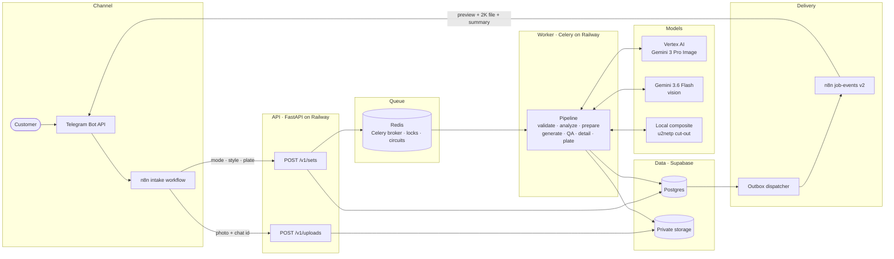
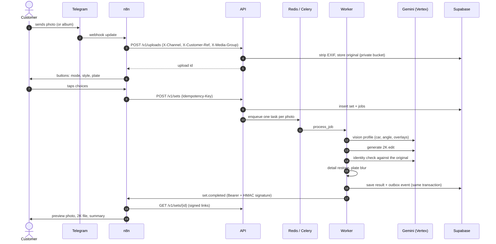
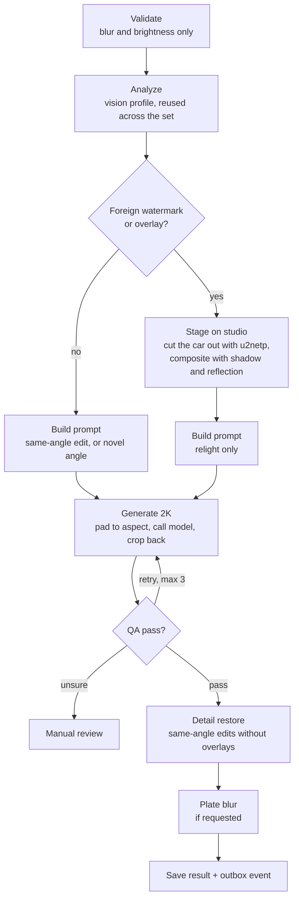
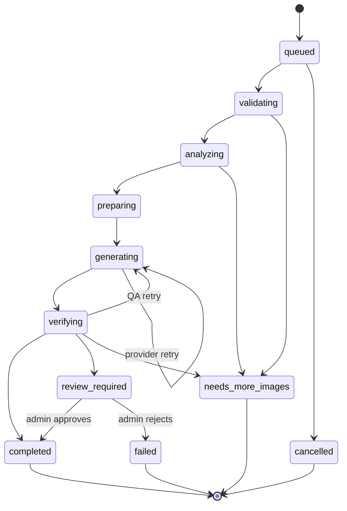
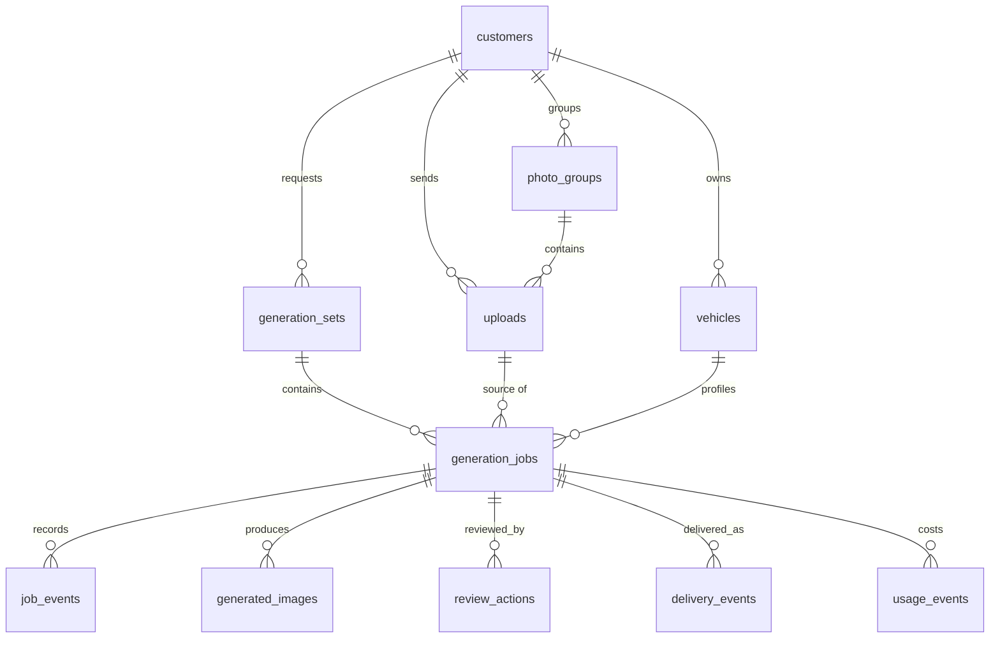

# CarStudio AI

[](https://github.com/PRCSM/carstudio-ai/actions/workflows/ci.yml)

Send a car photo to a Telegram bot and get back a 2K studio shot of the same car. The lighting and
background are generated; the car itself is checked against the original before anything is sent.

| | |
|---|---|
| **Interactive architecture** | https://architecture-production-6546.up.railway.app (click any card, or switch to *Flows* to watch one request move through the system) |
| **Try the bot** | https://t.me/carstudiobot_ai_bot |
| **Stack** | FastAPI · Celery + Redis · Supabase (Postgres + Storage) · n8n · Gemini 3 Pro Image on Vertex AI · Railway |


*Left: the photo as sent. Right: the result (Showroom style, plate blurred, 2752×1413).*

---

## Contents

1. [What it does](#1-what-it-does)
2. [Try it on Telegram](#2-try-it-on-telegram)
3. [System architecture](#3-system-architecture)
4. [One request, end to end](#4-one-request-end-to-end)
5. [Worker pipeline](#5-worker-pipeline)
6. [Job states](#6-job-states)
7. [Image models and the fallback chain](#7-image-models-and-the-fallback-chain)
8. [How quality is protected](#8-how-quality-is-protected)
9. [Data model](#9-data-model)
10. [API](#10-api)
11. [Reliability and cost controls](#11-reliability-and-cost-controls)
12. [Security and privacy](#12-security-and-privacy)
13. [Performance](#13-performance)
14. [Repository layout](#14-repository-layout)
15. [Configuration](#15-configuration)
16. [Running it](#16-running-it)
17. [Why Telegram and not WhatsApp](#17-why-telegram-and-not-whatsapp)
18. [Rollback](#18-rollback)
19. [Limits and next steps](#19-limits-and-next-steps)

---

## 1. What it does

- **Studio edit.** Replaces the background and lighting of 1 to 6 photos, keeping each car exactly as photographed.
- **Extra angles.** Generates new viewpoints (front, rear, sides, three-quarters) from 1 to 3 photos. These are labelled as AI visualizations, and the plate is rendered blank.
- **Three styles.** White Studio, Dark Luxury and Showroom.
- **Albums.** Photos sent together in Telegram become one set, with one summary message at the end.
- **Plate blur.** Optional, including mirrored plates in floor reflections.
- **Messy inputs.** Photos with watermarks, captions or screenshot UI still produce a clean result.
- **Full quality.** Every image comes back twice: as a Telegram photo for quick viewing and as an uncompressed 2K JPEG file.

## 2. Try it on Telegram

1. Open https://t.me/carstudiobot_ai_bot and tap **Start**.
2. Send a car photo, or up to 6 photos at once as an album.
3. Choose **Studio-edit my photos** or **Create extra angles**.
4. Pick a style and whether to blur the plate.
5. In about a minute you get a preview, the full 2K file and a summary. Send `/status` to see where your photo is.

## 3. System architecture



| Part | Runs on | Responsibility |
|---|---|---|
| n8n intake | n8n Cloud | Receives Telegram updates, uploads photos, asks for mode/style/plate with buttons, answers `/status` |
| API | Railway (`api` service) | Validates and stores uploads, creates sets and jobs, enforces quotas, serves signed result links |
| Worker | Railway (`worker` service) | Runs the pipeline, calls the models, writes results and events |
| Redis | Railway | Celery queue, per-job locks, circuit-breaker state |
| Postgres + Storage | Supabase | Source of truth; private buckets for originals and results |
| n8n job events | n8n Cloud | Receives "set completed" events and sends the images back to the chat |
| Architecture page | Railway (`architecture` service) | This repo's `docs/index.html`, served as a static site |

## 4. One request, end to end



## 5. Worker pipeline



| Step | What happens | Code |
|---|---|---|
| Validate | Rejects only photos that cannot work: sharpness under 15 or brightness under 20. A rejection comes with retake advice and does not count toward the quota. | `workers/pipeline.py` |
| Analyze | Gemini 3.6 Flash returns make, colour, angle and a list of overlays (watermarks, logos, captions, screenshot UI). Plate text is never stored. | `services/vision.py` |
| Stage on studio | For watermarked photos: the car is cut out and placed on a generated studio, so the watermark leaves with the old background. The model is then asked only to relight. | `providers/local_composite.py` |
| Build prompt | Chooses between a same-angle edit (with overlay clean-up), relight-only, or a novel viewpoint. The prompt version is stored with each result. | `services/prompts.py` |
| Generate 2K | Pads the photo to the nearest supported aspect ratio, requests `imageSize: 2K`, then crops back to the customer's exact framing. | `providers/gemini_provider.py` |
| QA | Technical checks plus a vision identity comparison. Fail means retry with a stricter prompt; unsure means manual review. | `services/qa.py` |
| Detail restore | Aligns the original onto the result and transfers real fine detail back onto the car. | `services/detail.py` |
| Plate blur | Finds plates, including reflections, and applies a feathered blur. | `services/plate.py` |

## 6. Job states

Every transition is validated and written to `job_events`.



Any non-terminal state can also move to `failed`. A set finishes when all of its jobs are terminal, and it then emits exactly one event: `set.completed`, `set.partial` or `set.failed`, with counts and grouped reasons for anything that needs a retake.

## 7. Image models and the fallback chain

Providers are tried top to bottom (`IMAGE_PROVIDER_CHAIN`).

| Order | Provider | Status | Cost per image | Skipped when |
|---|---|---|---|---|
| 1 | fal FLUX Kontext | inactive (no key) | ~$0.04 | not configured |
| 2 | **Vertex AI · Gemini 3 Pro Image** | **active** | ~$0.134 at 2K | circuit open, budget reached |
| 3 | AI Studio paid key | fallback | same model list | billing error (402) |
| 4 | AI Studio free tier | fallback | $0 | customer has not accepted training-data terms |
| 5 | Local composite | always available | $0 | never |

- **Model list with fallback.** Each Gemini provider tries `gemini-3-pro-image`, then `gemini-3.1-flash-image`, then `gemini-2.5-flash-image`. A 404 moves to the next model, and the working one is remembered.
- **Circuit breaker.** Credit, quota and auth failures open a circuit for that provider for 5 minutes, stored in Redis so every worker agrees.
- **Policy refusals stop the chain.** If a model refuses a prompt, the job does not shop around for another model that might comply.
- **Outages.** If every remote provider is temporarily down, the job is re-queued with backoff instead of failing.
- **Vision.** A separate list of 4 vision models (`GEMINI_VISION_MODEL`) handles the profile, the QA comparison and plate locations.

## 8. How quality is protected

**Identity QA.** Every result is compared with the original photo for edge overlap, framing and blank output, and the vision model is asked whether it is the same vehicle with nothing added or removed. During testing it caught a result where the model had removed the sunroof and invented a number plate; the job retried instead of sending it.

**Real 2K output in the customer's framing.** Gemini returns 2752×1536 for a 16:9 request. The photo is padded to the requested ratio first (with a blurred mirror the model replaces), and the result is cropped back to the original ratio, e.g. 2752×1413. Keeping the framing also stopped geometry failures that used to cost an extra paid attempt.

**Detail restore.** Image models soften fine detail. After QA, the original photo is aligned to the result (SIFT matches restricted to the car, ECC refinement, dense optical flow for local shifts) and its high-frequency luminance is transferred onto the car, only where:
- the alignment is trustworthy (edge correlation of at least 0.45),
- local structure agrees, so new studio reflections are not overwritten,
- the original actually has more detail than the AI output.

On a real test this raised sharpness on the car from 349 to 503 (+44%). It is skipped for watermarked photos, because it would copy the watermark back, and for new angles, which have no matching original.

**Clean edges.** The cut-out matte sits about 2 px inside the segmentation edge and edge colours are decontaminated, so there is no white halo around the car.

**Plates.** Plate boxes are located on the final image (including mirrored ones in reflective floors), and for our own composites the mirrored position is derived from the floor line, so a faint upside-down plate is blurred even if the vision model misses it.

**Output encoding.** Results are JPEG quality 95 with 4:4:4 chroma, and delivered as an uncompressed Telegram document as well as a preview photo.

## 9. Data model



- `customers` stores a salted hash of the channel id, never the raw Telegram id or phone number.
- `outbox_events` holds events written in the same transaction as the result they describe.
- `usage_events` records the estimated cost of every model and vision call; the budget guard reads it.
- Row-level security is on for every table, and `anon` / `authenticated` roles have no access. Only the service role used by the backend can read or write.
- Schema lives in `backend/migrations/` (4 migrations, applied to Supabase).

## 10. API

Customer endpoints accept two kinds of caller: n8n, with the internal bearer token plus `X-Channel` (`telegram` or `whatsapp`) and `X-Customer-Ref`; or a web client with an `X-Client-Session` id (for a future web demo). Admin endpoints need a separate admin token.

| Method | Path | Purpose |
|---|---|---|
| GET | `/health/live`, `/health/ready` | Liveness, and readiness (Postgres and Redis reachable) |
| POST | `/v1/uploads` | Upload one photo. `X-Media-Group` groups album photos. |
| POST | `/v1/sets` | Create a set (mode, style, plate option). Requires `Idempotency-Key`. |
| GET | `/v1/sets/{id}` | Set status and signed result links, labelled by angle |
| POST | `/v1/jobs` | Create a single job (v1 flow) |
| GET | `/v1/jobs/{id}` | Job status |
| GET | `/v1/me/jobs/latest` | Latest job for the caller (used by `/status`) |
| GET | `/v1/jobs/{id}/results` | Signed links to a job's results |
| POST | `/v1/jobs/{id}/cancel` | Cancel a job that is still queued |
| DELETE | `/v1/me/data` | Delete the caller's data and files |
| GET | `/v1/admin/review` | Jobs waiting for manual review (admin token) |
| POST | `/v1/admin/review/{id}` | Approve or reject a reviewed job (admin token) |

## 11. Reliability and cost controls

| Control | How it works |
|---|---|
| Job lock with heartbeat | Each job holds a 120 s Redis lock renewed every 40 s. If the worker process dies, the lock frees itself within 2 minutes. |
| Safe mode after a crash | A run that never finished is counted in Redis. The next run skips the optional local image steps (staging, detail restore, composite fallback). |
| Sweeper | Every 2 minutes, re-queues jobs stuck in `queued` for over 3 minutes and orphaned in-progress jobs after 5 minutes; fails jobs older than 2 hours. |
| Transactional outbox | The delivery event is committed with the result, then sent by a dispatcher every 15 s with exponential back-off. A result can never exist without its delivery. |
| Idempotency | `POST /v1/sets` and `POST /v1/jobs` require an idempotency key, so a double tap never creates or charges twice. |
| Monthly budget | Paid calls stop at `MONTHLY_SPEND_LIMIT_USD`; the free local composite still answers. |
| Daily quota | Per customer per day (40 in the test deployment). Refused photos do not count. |
| Memory | Worker peak is about 250 MB of its 1 GB limit. One fresh process per job; the detail step checks cgroup headroom and skips itself rather than risk an out-of-memory kill. |
| Retention | Originals and results are deleted after `IMAGE_RETENTION_DAYS` (30 by default). |

## 12. Security and privacy

- EXIF and GPS data are stripped on upload; file type is sniffed from the bytes, not the extension.
- Decompression-bomb guard and size limits: 15 MB, 40 megapixels, at least 512 px on the short side.
- Storage buckets are private. n8n only ever receives signed links that expire after 15 minutes.
- n8n and the API authenticate each other with a bearer token; outgoing events also carry an HMAC-SHA256 signature and timestamp.
- Number-plate text is never written to the database or logs.
- No secrets in the repository; everything is read from environment variables (see `.env.example`).
- `WATERMARK_POLICY=remove` is a testing setting for this private project. For public use it should be `ask_original`, which asks the customer for an unwatermarked photo.

## 13. Performance

Measured on test jobs, 7 Nov 2026, one photo, first attempt approved:

| Stage | Time |
|---|---|
| Customer picks options in Telegram | ~20 s |
| Upload and queue | ~6 s |
| Validate and analyze | ~9 s |
| Prepare (staging for watermarked photos) | 2 to 5 s |
| Generate 2K (Gemini 3 Pro Image) | 22 to 30 s |
| QA, detail restore, plate blur, upload | ~20 s |
| Dispatch to n8n | 0 to 15 s |
| Telegram delivery (preview, file, summary) | ~14 s |
| **Total after picking options** | **~60 to 85 s** |

Each QA retry adds 35 to 45 s. Cost is about $0.134 per 2K image plus about $0.004 per vision call.

## 14. Repository layout

```
.
├── backend/
│   ├── app/
│   │   ├── api/          routes.py (endpoints), deps.py (auth, quotas, customer lookup)
│   │   ├── core/         config.py (settings and feature flags), security.py, logging.py
│   │   ├── db/           SQLAlchemy models and session
│   │   ├── providers/    chain.py, gemini_provider.py, fal_provider.py, local_composite.py
│   │   ├── services/     vision, qa, detail, plate, prompts, preprocess, storage, budget, job_state
│   │   └── workers/      celery_app.py, tasks.py, pipeline.py
│   ├── migrations/       Supabase SQL migrations
│   ├── tests/            66 tests, run in CI
│   └── Dockerfile        API and worker image (u2netp model baked in)
├── n8n/                  Telegram intake and delivery workflows (n8n Workflow SDK)
├── docs/
│   ├── index.html        interactive architecture board
│   ├── rollback.md       switch-over and rollback steps
│   └── assets/
├── infra/                local docker compose, Railway notes
└── .github/workflows/    CI: ruff, pytest, import check, Docker build
```

## 15. Configuration

The full list is in [`.env.example`](.env.example). The ones that change behaviour most:

| Variable | Test deployment | Meaning |
|---|---|---|
| `IMAGE_PROVIDER_CHAIN` | `fal_flux_kontext,vertex_gemini,gemini_paid,gemini_free,local_composite` | Provider order |
| `GEMINI_IMAGE_MODEL` | `gemini-3-pro-image,…,gemini-2.5-flash-image` | Image models, best first |
| `IMAGE_OUTPUT_SIZE` | `2K` | `1K`, `2K` or `4K` for Gemini 3 image models |
| `GEMINI_VISION_MODEL` | `gemini-3.6-flash,…` | Vision models, best first |
| `FEATURE_SETS` | `true` | Albums of up to 6 photos |
| `FEATURE_NOVEL_ANGLES` | `true` | Extra-angle generation |
| `FEATURE_PLATE_BLUR` | `true` | Plate blur option |
| `FEATURE_OVERLAY_CLEANUP` | `true` | Remove captions, stickers, screenshot UI |
| `WATERMARK_POLICY` | `remove` | `remove` (testing) or `ask_original` |
| `DETAIL_TRANSFER` / `DETAIL_STRENGTH` | `true` / `0.85` | Detail restore on and how strong |
| `COMPOSITE_FALLBACK` | `true` | Use the local composite when models refuse or fail |
| `MONTHLY_SPEND_LIMIT_USD` | `5` | Paid-call budget |
| `DAILY_CUSTOMER_QUOTA` | `40` | Jobs per customer per day |
| `MAX_GENERATION_ATTEMPTS` | `3` | QA retries |

## 16. Running it

**Tests**

```bash
cd backend
pip install -e ".[dev]"
ruff check app tests
pytest -q
```

**Locally with Docker**

```bash
cp .env.example .env        # fill in Supabase and model keys
docker compose -f infra/docker-compose.local.yml up --build
```

**On Railway**

- `api` and `worker` both build from `backend/Dockerfile` (root `/backend`).
- The worker runs `celery -A app.workers.celery_app worker -B --concurrency=1 --max-tasks-per-child=1 --max-memory-per-child=600000`.
- `architecture` serves `docs/` as a static site and redeploys only when `docs/` changes.
- Details are in [`infra/railway-deployment.md`](infra/railway-deployment.md).

**n8n.** Workflow sources and credential setup are in [`n8n/`](n8n/README.md).

## 17. Why Telegram and not WhatsApp

The brief asked for WhatsApp. When registering the WhatsApp Business number, Meta blocked the change on the account with a device-security error, so a number could not be registered in time. To keep the whole flow testable, the chat channel was built on Telegram.

The backend does not depend on the chat app: the API already accepts `X-Channel: whatsapp`, customers are stored per channel, and delivery goes through the outbox. Moving to the WhatsApp Cloud API means connecting a verified number and replacing the two n8n workflows. Nothing in the API or worker changes.

## 18. Rollback

Every v2 feature is behind a flag, and the original working build is kept on the `stable/v0.1` branch.

- `GEMINI_IMAGE_MODEL=gemini-2.5-flash-image` returns to the earlier 1K model.
- `DETAIL_TRANSFER=false` turns off detail restore.
- `FEATURE_*=false` turns off albums, extra angles, plate blur or overlay clean-up individually.

Full steps are in [`docs/rollback.md`](docs/rollback.md).

## 19. Limits and next steps

- **Single worker slot.** Photos are processed one at a time, so a 6-photo album takes about 6 minutes. Running 2 to 3 jobs in parallel (memory now allows it) would roughly halve that.
- **Delivery waits for the next dispatch tick.** Sending events immediately when a job finishes would remove up to 15 s.
- **QA and plate detection run one after the other.** Running them together would save about 6 to 8 s per photo.
- **Extra angles are visualizations.** They are labelled as such and can differ from the real car in hidden areas.
- **Benchmark.** The model choice should be validated on a larger set of real, consented customer photos.
